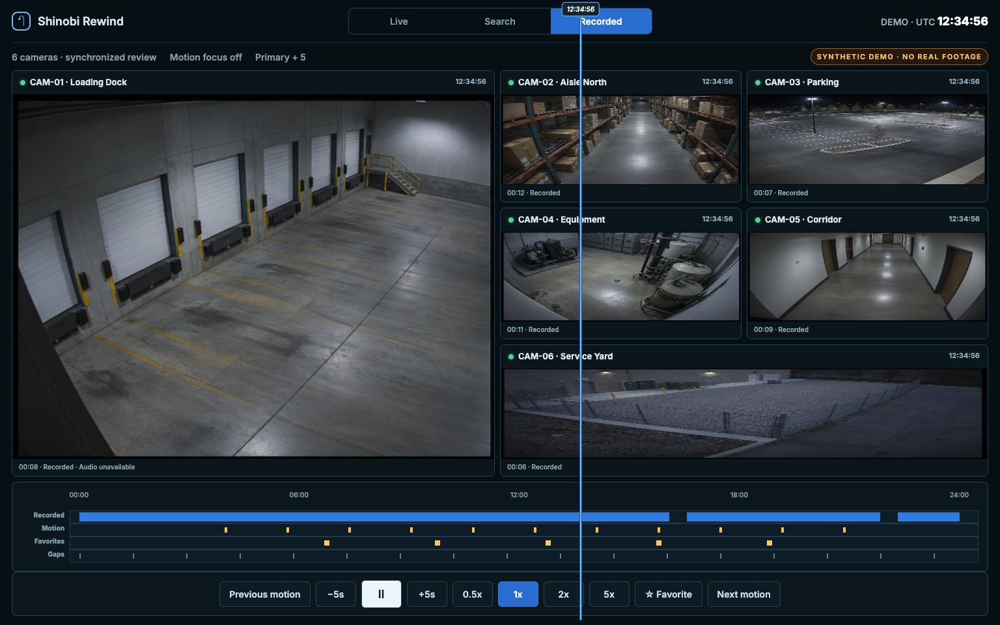

# Shinobi Rewind

[English](README.md) | [한국어](README_KOR.md)

정확한 시간으로 Shinobi 녹화 영상을 찾고, 최대 6대의 카메라를 하나의 공유 타임라인에서 검토하며, 명시적으로 즐겨찾기한 구간을 별도의 아카이브 드라이브에 보존할 수 있게 해 주는 비공식 셀프 호스팅 companion입니다.



_합성 데모일 뿐입니다. 실제 CCTV 영상, 현장 정보, 개인 주소, 운영자 데이터는 표시되지 않습니다._

운영자 UI는 한국어와 영어를 지원합니다. 상단 바의 언어 전환 설정은 브라우저 저장소에 저장됩니다. 처음 방문한 사용자는 브라우저 언어를 따르며, fallback은 영어입니다.

## 실행

`make run`은 내장 React UI를 빌드하고 `http://localhost:8080`에서 데모 모드로 실행합니다. 데모 모드에는 녹화, 공백, 손상된 타임라인 상태가 포함되어 있으며, 의도적으로 `모션 데이터 사용 불가 · detector off`라고 표시합니다.

실제 읽기 전용 설치에서는 `.env.example`을 `.env`로 복사하고, `DEMO_MODE=false`를 설정한 뒤 `SHINOBI_URL`, `SHINOBI_GROUP_KEY`, `SHINOBI_API_KEY`를 secret manager를 통해 제공하세요. 라이브 뷰에는 `LIVE_HLS_URL`을 통한 전용 RTSP-to-HLS bridge를 권장합니다. 이렇게 하면 라이브 뷰 재연결이 Shinobi 녹화와 독립적으로 동작합니다. Bridge 경로명은 서버 측에서 카메라 ID와 화질을 바탕으로 생성됩니다. `SHINOBI_LOW_STREAM_CHANNEL`은 선택적 호환 경로로 남아 있으며, 녹화 카메라와 multi-input FFmpeg 프로세스를 공유해서는 안 됩니다. 인증 정보와 upstream 녹화 경로는 브라우저로 전송되지 않으며 요청 로그에도 포함되지 않습니다.

포함된 Compose 예시는 기존 `cctv` Docker 네트워크에 참여하며, 기본적으로 `127.0.0.1:8092`에 바인딩됩니다. 배포 환경에서는 `SHINOBI_REWIND_BIND_IP`와 `SHINOBI_REWIND_PORT`를 override하세요. 사이트별 주소는 공개 저장소에 넣지 마세요.

## 컨테이너 이미지

릴리스 태그는 multi-stage Docker 이미지를 `ghcr.io/blkpark/shinobi-rewind`에 게시합니다. 프로덕션에서는 floating tag 대신 릴리스된 버전을 고정해서 사용하세요.

```sh
docker pull ghcr.io/blkpark/shinobi-rewind:v0.5.1
```

이미지에는 이 프로젝트의 라이선스와 [서드파티 고지](THIRD_PARTY_NOTICES.md)가 포함되어 있습니다. 그래도 로컬 `.env`, 신뢰할 수 있는 네트워크, 기존 Shinobi 배포는 필요합니다.

`npm`은 내장 웹 UI를 빌드할 때만 필요합니다. 실행 중인 Go 서비스와 릴리스 이미지는 npm 캐시를 사용하지 않습니다. 커스텀 캐시 위치가 필요한 빌드 호스트는 셸이나 CI 환경에서 `NPM_CONFIG_CACHE`를 설정할 수 있습니다. 이 빌드 전용 경로를 애플리케이션 런타임 `.env` 파일에 넣지 마세요.

## 보안 경계

Shinobi Rewind는 신뢰할 수 있는 LAN 또는 인증된 VPN/reverse proxy 환경을 전제로 설계되었습니다. 자체 사용자 인증 기능은 제공하지 않습니다. 특히 아카이브 생성은 쓰기 작업이므로, 서비스를 공용 인터넷에 직접 노출해서는 안 됩니다. 모든 route가 외부 접근 제어 계층으로 보호되지 않는 한 기본 loopback bind를 유지하세요. 실제 카메라로 운영하기 전에 [SECURITY.md](SECURITY.md)를 확인하세요.

즐겨찾기 보존 기능을 활성화하려면 `ARCHIVE_ROOT`를 전용 쓰기 가능 디렉터리로 설정하세요. 서비스는 Shinobi에서 완료된 원본 세그먼트를 `.part` 파일로 스트리밍하고, 바이트 수와 SHA-256 digest를 검증한 뒤, 검증된 복사본만 원자적으로 게시합니다. 아카이브는 의도적으로 브라우저의 즐겨찾기 제거와 독립적으로 동작하며, LAN 서비스에 인증 경계가 없는 동안에는 영구 삭제 API를 노출하지 않습니다.

## API

`GET /api/v1/capabilities`, `/cameras`, `/timeline?date=YYYY-MM-DD&camera=...`, `/events?from=RFC3339&to=RFC3339&camera=...`, 그리고 `GET|HEAD /api/v1/videos/{opaqueId}`를 제공합니다. 비디오 프록시는 버퍼링 없이 HTTP range를 전달합니다. 공백, 손상, malformed, 재생 불가 세그먼트는 안전한 오류를 반환합니다. 아카이브 API는 idempotent한 즐겨찾기 보존 요청을 받고, KST 날짜 또는 월 기준으로 목록을 제공하며, 검증된 artifact에 대해서만 HTTP Range 미리보기를 제공합니다.

타임라인 세그먼트의 `hasAudio`는 `true`, `false`, `null` 중 하나로 노출됩니다. 명시적인 Shinobi 비디오 메타데이터만 true/false가 되며, 누락되었거나 애매한 메타데이터는 추측하지 않고 null로 유지합니다. 브라우저는 소리가 나는 카메라를 최대 하나만 유지하고, 4배속을 초과하면 오디오를 음소거합니다.

컨트롤 뷰는 카메라당 활성 비디오 하나를 유지하고, fullscreen fallback이 있는 네이티브 PiP, 0.25x-20x 커스텀 속도, 고정 playhead drag/zoom, 직접 시간 이동, 방향키 ±5초 이동, absolute-KST 로컬 즐겨찾기를 지원합니다. Incident search는 월에서 주, 일 단위로 좁혀 들어가며 detector-off, zero-event, no-data, partial failure를 서로 구분해서 유지합니다.

## 검사

`make fmt test lint typecheck build`를 실행하세요. 프론트엔드는 React/Vite/TypeScript만 사용하며, 백엔드는 Go 표준 라이브러리를 사용합니다.

## 오픈소스 상태

소스는 MIT 라이선스이며, 인증 정보가 없는 데모 모드를 포함합니다. 셀프 호스팅 평가와 신뢰할 수 있는 네트워크 사용에 적합하지만, `0.5.x` 버전은 beta로 간주해야 합니다. 배포 시에는 자체 인증 경계, Shinobi 인스턴스, 아카이브 저장소, 선택적 RTSP-to-HLS bridge를 직접 제공해야 합니다.

Shinobi Rewind는 Shinobi Systems와 제휴되어 있지 않으며, Shinobi Systems의 보증이나 지원을 받지 않습니다. Shinobi 소스 코드를 포함하지 않습니다. 운영자는 자신의 설치에 적용되는 [Shinobi 라이선스](https://gitlab.com/Shinobi-Systems/Shinobi/-/blob/master/LICENSE.md)와 카메라 벤더 약관을 준수할 책임이 있습니다.

기여 규칙은 [CONTRIBUTING.md](CONTRIBUTING.md), 비공개 취약점 제보는 [SECURITY.md](SECURITY.md), 번들된 의존성 고지는 [THIRD_PARTY_NOTICES.md](THIRD_PARTY_NOTICES.md)를 참고하세요.

## 라이브 연동 참고

라이브 모드는 Shinobi에 문서화된 `/{apiKey}/videos/{groupKey}/{monitorId}` 및 `/{apiKey}/events/{groupKey}/{monitorId}` route를 KST `start`, `end` 범위와 함께 사용하며, `{videos:[...]}`와 `{events:[...]}` envelope를 디코딩합니다. UI는 detector/event source를 사용할 수 없을 때 모션이 없다고 주장하지 않도록 의도적으로 설계되어 있습니다.
